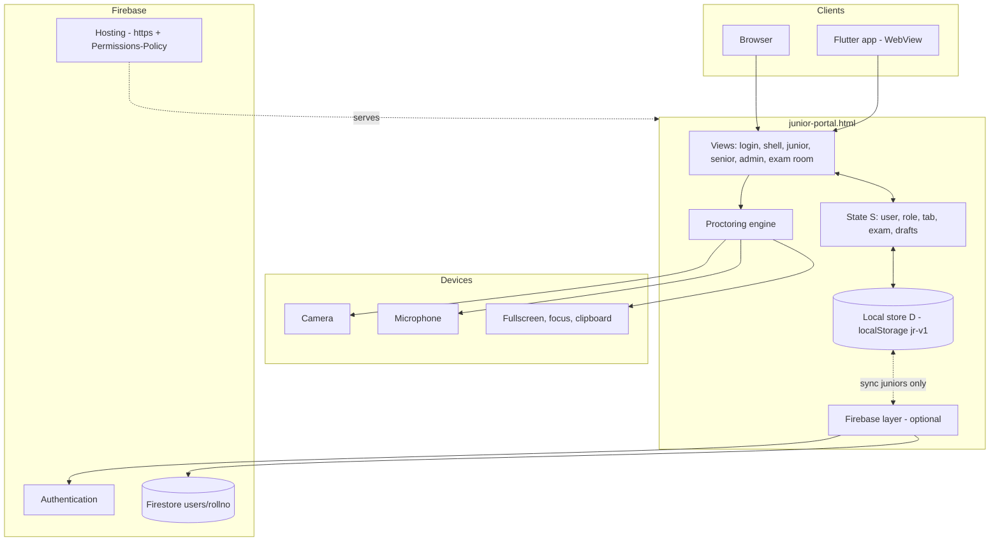
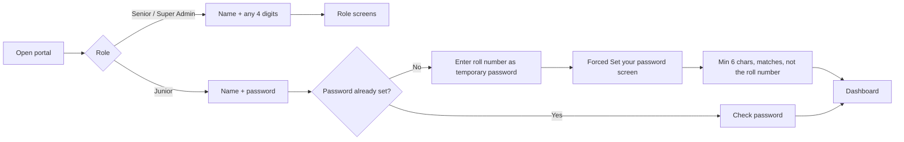
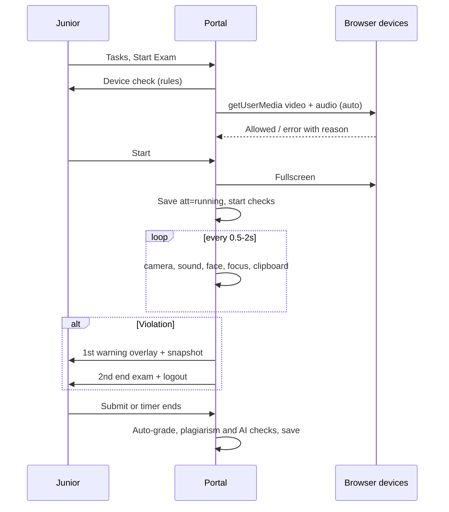

# CSSP Senior Mentor Tracker Portal · SR University

A single-file web app for the Senior Mentor Tracker programme. **Juniors** report weekly LeetCode progress, submit assessments and take **camera-proctored tasks and live interviews**. **Seniors** verify progress, publish tasks, schedule Zoom interviews and review every submission from their juniors. The **Super Admin** assigns assessments and can see and act on everything.

The same file runs in a browser, on Firebase Hosting, and inside a Flutter app (WebView).

> **Status:** all three roles are built. The data layer is **browser-local by default** (one shared browser = one shared dataset). Firebase sync currently carries **each junior's own data only**. Senior/admin data, real senior/admin logins, file storage and cross-device sharing are **not built yet** (see [Limitations](#13-security-model-and-limitations) and [Roadmap](#15-roadmap)). Firebase and Flutter parts were written but **not tested against a live Firebase project or a physical phone**. There is **no demo data**: everything starts empty except the student list.

---

## Contents

1. [Features by role](#1-features-by-role)
2. [Tech stack and files](#2-tech-stack-and-files)
3. [Architecture](#3-architecture)
4. [Data model](#4-data-model)
5. [Login and first-time password](#5-login-and-first-time-password)
6. [Junior flows](#6-junior-flows)
7. [Senior flows](#7-senior-flows)
8. [Super Admin flows](#8-super-admin-flows)
9. [Proctoring engine](#9-proctoring-engine)
10. [Firebase integration](#10-firebase-integration)
11. [Flutter wrapper](#11-flutter-wrapper)
12. [Deployment and setup](#12-deployment-and-setup)
13. [Security model and limitations](#13-security-model-and-limitations)
14. [Configuration reference and test checklist](#14-configuration-reference-and-test-checklist)
15. [Roadmap](#15-roadmap)

---

## 1. Features by role

### 🎓 Junior
| Tab | What they can do |
|---|---|
| **📊 Dashboard** | Week, plan target, latest count, pending counts, progress bars, to-do list |
| **🧑‍💻 My Work** | Add 6 profile links; submit weekly LeetCode total + one problem to explain; see senior verification; mock card; 12-week history; **change password** |
| **📝 Assessments** (Super Admin, *open mode*) | Submit MCQ, fill-in-the-blank, written, mixed quiz, link, file (PDF/Word/TXT) or practice-done. Tabs, notes and links allowed. No camera. |
| **🔒 Tasks** (Senior, *proctored*) | MCQ / blanks / written tasks on this site only, with camera + mic proctoring. Live interviews: join on Zoom, or in the proctored in-site room. |

### ✔ Senior (sees only their own juniors)
| Tab | What they can do |
|---|---|
| **📊 Dashboard** | Juniors, submitted, awaiting review, verified, doubtful, below target, missing links, terminated exams |
| **👥 My Juniors** | Review weekly submission; enter real count; mark **Verified / Doubtful / Not checked**; seriousness; remarks; open **All data & submissions** for a junior |
| **📥 Submissions** | Every junior's code links, written answers, files and MCQ results per assessment; enter marks |
| **🔒 Tasks** | Publish proctored tasks with a question builder; review attempts, proctor logs, flags; enter marks |
| **🎥 Interviews** | Schedule with date/time, duration, topics and a **Zoom link**; **▶ Start meeting**; see join times; record score /10, recommendation, notes |

### 🏛 Super Admin (all six admins have the same access)
| Tab | What they can do |
|---|---|
| **📊 Overview** | Totals plus a card per senior |
| **👥 All Juniors** | Search all 73 students; open every submission, task attempt and interview; **reset password** (offline mode) |
| **📝 Assessments** | Assign assessments with an **auto-switching builder**; view all submissions; enter marks; delete |
| **🧑‍🏫 Seniors** | Expand a senior's juniors; **Open as this senior →** to do anything that senior can do |

Programme data (in code): 73 juniors under 6 student mentors (batches G6-B1…B4), 12 weeks from **5 Oct 2026**, cumulative targets `98, 111, 141, 156, 170, 184, 207 …`.

---

## 2. Tech stack and files

- **App:** one HTML file, vanilla JavaScript, no framework or build step. Views are template strings written into `#app`.
- **Storage:** `localStorage` key `jr-v1`; optional mirror to **Firestore**.
- **Auth:** offline SHA-256 password hash (juniors); optional **Firebase Authentication** (email + password).
- **Browser APIs:** `getUserMedia`, `AudioContext`, Fullscreen, Page Visibility, clipboard events, optional `FaceDetector`.
- **Mobile:** Flutter WebView app (`webview_flutter`, `permission_handler`).

```
junior-portal.html            # the whole portal (open directly in Chrome)
portal-package/
├── public/
│   ├── index.html            # same portal + <script src="firebase-config.js">
│   └── firebase-config.js    # paste Firebase web config (blank = offline mode)
├── firebase.json             # Hosting + Permissions-Policy (camera, mic, fullscreen)
├── firestore.rules           # each junior reads/writes only users/<rollno>
├── flutter_app/
│   ├── pubspec.yaml
│   └── lib/main.dart         # WebView that grants camera + mic
└── README.md
```

Script order inside the HTML: helpers → storage `D` → student list `JUN` → targets/schedule → state `S` + `render()` → login/password → views (shell, dashboard, work, assessments, tasks) → proctoring engine → Senior views → Super Admin views → assessment/task builder → Firebase layer.

---

## 3. Architecture



**Design points**

- **One `render()`:** picks the screen from state: senior/admin → login → forced password screen → exam room → tabbed shell.
- **One shared shell:** `shell()` draws the sidebar (desktop) or top bar + bottom tabs (phone) for all roles.
- **Local first:** every write goes to `D` and `localStorage`; with Firebase on, `save()` also pushes the junior's slice.
- **Exam room replaces the shell** while a task runs, and the camera `<video>` lives on `<body>` so re-renders never kill the stream.
- **Items created by seniors/admin** (`D.mk`) are loaded into the live arrays `A` (tasks), `INT` (interviews), `AS` (assessments) at startup.

---

## 4. Data model

### Static (in code)
| Name | Purpose |
|---|---|
| `JUN` | 73 students `{roll, name, sr (mentor full name), batch}` |
| `SENIORS`, `SMAP` | 6 login names → mentor full names |
| `T`, `W0`, `cw()` | weekly targets, week-1 start, current week index |
| `LK` | profile link keys: lc, cf, hr, li, gh, cv |
| `A`, `INT`, `AS` | tasks, interviews, assessments (start empty; filled from `D.mk`) |

### Stored `D` (browser, partly Firestore)
```js
D = {
  links: { [roll]: { lc, cf, hr, li, gh, cv } },
  sub:   { "roll|week": { n, p, at } },                  // weekly submission
  ver:   { "roll|week": { st, rc, sn, rem, by, at } },   // senior verification
  asm:   { "assessmentId|roll": { ty, ans, sc, at } },   // assessment submission
  am:    { "assessmentId|roll": marks },                 // assessment marks
  att:   { "taskId|roll": { st:'running|done|terminated', reason, auto, ans,
                            strikes, log:[{t,r,img}], flags:[], si, at } },
  tm:    { "taskId|roll": marks },                       // task marks
  jn:    { "interviewId|roll": "join time" },            // Zoom join
  iv:    { "interviewId|roll": { sc, rec, n, by } },     // interview evaluation
  pw:    { [roll]: { h: sha256, at } },                  // offline passwords
  mk:    { t:[tasks], i:[interviews], a:[assessments] }  // created by senior/admin
}
```
Firestore document: `users/{rollno}` → `{ data: <that junior's links/sub/asm/att>, pwSet, at }` (file bytes stripped).

### Question objects
`{t:'mcq', q, o:[...], k:index}` · `{t:'blank', q, a:[accepted answers]}` · `{t:'text', q}`.
Assessment `ty`: `mcq · blank · text · mixed · link · file · done` (`text` stores plain strings).

---

## 5. Login and first-time password



- **Offline:** the hash is stored in `D.pw`. **Change password** is on My Work. The Super Admin can **Reset password** (back to the roll number) from All Juniors.
- **Firebase:** account `rollno@cssp.sru`; first login creates it with the roll number; the new password is set with `updatePassword` and `pwSet:true` is stored. Admin reset needs a Cloud Function (not built).
- **Seniors / Super Admin** still accept any 4 digits (prototype).

---

## 6. Junior flows

**Weekly work:** My Work → counter (− / +) shows *Target met* or *N below target* → optional "problem I can explain" → Submit. Status moves from **⏳ Awaiting review** to **✓ Verified** or **⚠ Doubtful** after the senior acts.

**Assessments (open mode):** each card shows its type; **Answer / Submit** opens the matching form: radio options (MCQ), text box (blank), text area (written), per-question format (mixed), solution-link field (link), file picker `.pdf .doc .docx .txt` ≤ 700 KB (file), or **Mark as done** (practice). MCQ and blanks are auto-scored; marks entered later appear on the card.

**Proctored task**

Room: sticky header (title, violations 0/2, timer, Submit), live status chips, camera side dock (desktop) with **● LIVE · PROCTORED** label. A **Turn on camera & mic** button appears if devices are off.

**Interviews**
- **With a Zoom link:** card shows *Upcoming → Join now → Joined / Missed*. The link unlocks 5 min before start; **Join live interview on Zoom** opens it in a new tab and records the join time. Not camera-proctored on this site (Zoom is using the devices).
- **Without a link:** joins the in-site proctored room (camera, mic, two-strike rule, leave once only).
- The senior's score, recommendation and notes appear on the card.

---

## 7. Senior flows

1. **Verify weekly work:** My Juniors → *Review & verify* → shows submitted count, links, explain-problem → enter real count, verification, seriousness, remarks → Save. The junior sees the result.
2. **See everything:** *All data & submissions* shows weekly table, links, assessment answers/links/files, task attempts with proctor evidence, interview status. **📥 Submissions** lists the same per assessment with a marks box.
3. **Publish a task:** Tasks → pick **Question type**; the builder switches automatically:

| Type | Builder |
|---|---|
| 🧩 Mixed | each question has its own type menu |
| ☑ MCQ | options + radio for the correct one (+ option) |
| ▭ Blanks | write `____`; accepted answers separated by `;` |
| ✍ Written | question boxes |

   Title, instructions, due date, duration, max marks. Validation: question text required; MCQ ≥ 2 options + a correct one; blanks need an answer. Empty option boxes are ignored and the correct index is remapped.
4. **Review attempts:** answers (MCQ shown as option text), **Integrity** rating (clean / review / HIGH RISK), proctor snapshots, flags; enter marks.
5. **Schedule an interview:** title, date/time, duration, topics, Zoom link → *▶ Start meeting (host)* → after the call, *Save evaluation* (score /10, Needs practice / On track / Strong, notes).

---

## 8. Super Admin flows

- **Assign an assessment:** choose **Submission type** and the form changes at once:

| Type | Builder shown |
|---|---|
| ☑ MCQ / ▭ Blanks / ✍ Written / 🧩 Mixed | same question builder as tasks |
| 🔗 Link | problem link (required) |
| 📎 File | optional reference link + upload note |
| ✓ Practice | practice link |

  Plus instructions, due date and max marks (default = number of auto-graded questions). Published to **all** juniors.
- **Review:** *Submissions & marks* per assessment; *All Juniors* for any student's full record.
- **Act as a senior:** *Seniors → Open as this senior →* shows a banner and gives that senior's full screens; **← Back to Super Admin** returns.

---

## 9. Proctoring engine

| Check | How | Trigger |
|---|---|---|
| Tab switch / minimise | `visibilitychange` | hidden |
| Left window | `blur` | any |
| Exit full-screen | `fullscreenchange` (if entered) | exited |
| Split screen / resize | size vs start (skipped on phones) | below 70% |
| Copy / cut / paste / drop | events blocked | any |
| Auto-inserted text | input type paste/drop/yank, or > 25 chars at once; reverted | any |
| Camera covered | 32×24 luminance every 2 s | < 12 for 2 checks |
| Camera frozen | frame difference | < 0.12 for 8 checks |
| Camera / mic off | track `readyState` | not live |
| Face missing / several | `FaceDetector` (where supported) | 3 misses / > 1 |
| Talking / noise | analyser RMS vs baseline from first 3 s | above max(0.07, 3.5×baseline) for 6 samples |
| Dev shortcuts | F12, PrintScreen, Ctrl+U/S/P, Ctrl+Shift+I/J/C blocked | blocked, not counted |

**Strike rule:** violations within 3 s count once; 2 s grace at start and after a warning. **1st = warning with snapshot. 2nd = exam ends, saved, logged out, no reattempt.** Refreshing mid-exam counts as interrupted.

**Device check screen:** camera preview, live mic bar, "allowed ✓" badges, specific errors (denied, none found, in use, embedded page).

**Answer-integrity flags:** text mostly not typed (> 200 chars, keystrokes < 40% of length) · AI-style phrases (≥ 2) · long answer with zero corrections (> 250 chars) · typing faster than 10 chars/s · word-trigram similarity ≥ 0.35 with another student's answer (flagged on both). Rating: 0 → clean, 1–2 → review, ≥ 3 → HIGH RISK (violations count double). These are indicators, not proof.

---

## 10. Firebase integration

Off by default; fill `public/firebase-config.js` to enable.

- SDK v10.12.2 modules imported on demand from `gstatic.com`.
- **Login:** `rollno@cssp.sru` + password; first login with the roll number, then forced password change (`updatePassword`).
- **Sync:** `save()` → `fbPush()` writes `users/{roll}` with merge; login → `fbLogin()` loads and merges.
- **Rules:** a user may read/write `users/{roll}` only if `request.auth.token.email == roll.lower() + '@cssp.sru'`.
- **Hosting header:** `Permissions-Policy: camera=(self), microphone=(self), fullscreen=(self)`.

**Not synced yet:** tasks, interviews and assessments published by seniors/admin, verifications, marks, evaluations, join times, file contents. Seniors/admin have no Firebase login.

---

## 11. Flutter wrapper

`lib/main.dart` shows the hosted portal in a WebView, grants the page's camera/mic request (`setOnPlatformPermissionRequest`) and asks the OS for permission.

- Load `https://<project>.web.app/?app=1` (`?app=1` lets proctored tasks run on phones).
- Android WebView usually refuses the full-screen request; other checks still run.
- Not included: screenshot blocking, native face detection.
- It is a WebView, not a native Dart rewrite.

---

## 12. Deployment and setup

**Local (camera works):** save `junior-portal.html`, open in Chrome. Browser-only storage.

**Firebase Hosting**
1. Create a project; enable **Authentication → Email/Password**, **Firestore** (and Storage later).
2. Paste the web-app config into `public/firebase-config.js`.
3. `npm i -g firebase-tools && firebase login && firebase init` (Hosting + Firestore, keep files) → `firebase deploy`.
4. Share `https://<project>.web.app`.

**Flutter:** `flutter create cssp_junior`; copy `pubspec.yaml` and `lib/main.dart`; set `kPortalUrl`; Android permissions `INTERNET, CAMERA, RECORD_AUDIO, MODIFY_AUDIO_SETTINGS`, `minSdkVersion 21`; iOS `NSCameraUsageDescription`, `NSMicrophoneUsageDescription`; `flutter pub get && flutter run`.

> Camera and microphone need a top-level page on **https** or a local file. Embedded previews block them.

---

## 13. Security model and limitations

- **Shared data:** by default every person's data lives in their own browser. A senior and a junior on different devices do **not** see each other's data until senior/admin data moves to Firestore.
- **Senior/Super Admin PINs:** any 4 digits; no real login yet.
- **Temporary password** is the roll number (guessable); a one-time code from the admin would be safer.
- **Client-side proctoring** deters and records; a determined user can bypass it. Use a human invigilator for high-stakes exams.
- **Cannot detect:** phones or second screens out of camera view, specific AI tools, spoken words (only sound level; audio is **not recorded**).
- **Face detection** needs a browser with `FaceDetector`; otherwise only the other camera checks run.
- **Zoom interviews** are not camera-proctored on this site.
- **Copy checks** compare only attempts in the same browser.
- **Uploaded file contents** stay local (name and size only sync).
- **`?app=1`** can be added by anyone; it is a convenience, not a lock.

---

## 14. Configuration reference and test checklist

| Item | Where |
|---|---|
| Firebase keys | `public/firebase-config.js` → `window.FIREBASE_CONFIG` |
| Week 1 date / targets | `W0`, `T` |
| Student list | `G` blocks → `JUN` (`rollno NAME` per line) |
| Senior/admin names | `SENIORS`, `SMAP` |
| Storage key | `jr-v1` (change to reset local data) |
| Violation limit | `strike()` (2 = terminate) |
| Upload limit | `asmFile()` (700 KB, `.pdf .doc .docx .txt`) |
| Portal URL in app | `kPortalUrl` in `main.dart` (keep `?app=1`) |

**Test checklist**
- [ ] Junior first login with roll number → forced password screen → new password works, roll number no longer does.
- [ ] Change password from My Work; admin reset returns to roll-number login.
- [ ] Weekly submit → senior verifies → junior sees ✓ / ⚠.
- [ ] Admin publishes each assessment type; junior submits each; MCQ/blank auto-score; marks appear.
- [ ] Senior publishes Mixed, MCQ, Blank, Written tasks; invalid builder input is rejected.
- [ ] Task: allow camera/mic → preview + mic bar; Start unlocks; 1st violation warns; 2nd ends and logs out; no reattempt.
- [ ] Paste blocked; covered camera flagged after ~4 s.
- [ ] Interview with Zoom link: opens 5 min early, join time recorded; evaluation visible to junior.
- [ ] Super Admin: search a junior, open all data, *Open as this senior*, back.
- [ ] Firebase on: second device sees the junior's own data.

---

## 15. Roadmap

1. **Shared backend:** Firestore collections for tasks, interviews, assessments, verifications, marks, evaluations, attempts; security rules per role.
2. **Real logins** for seniors and Super Admin (email + password); admin password reset via Cloud Function.
3. **Cloud Storage** for uploaded files and proctor snapshots.
4. **Cloud Function** for cross-student similarity checks.
5. **In-site live video** (WebRTC + signaling) as an alternative to Zoom.
6. **Flutter native:** ML Kit face detection, screenshot blocking, app-lifecycle violations.
7. Admin tools: edit weekly targets and student list, import from Excel/CSV, exports.
